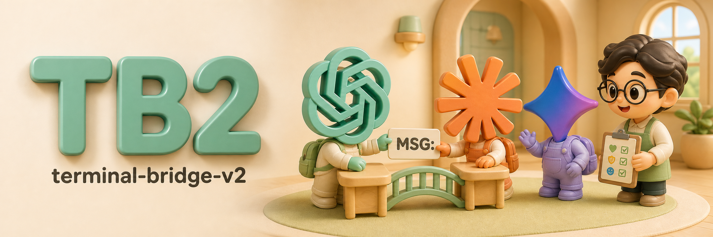
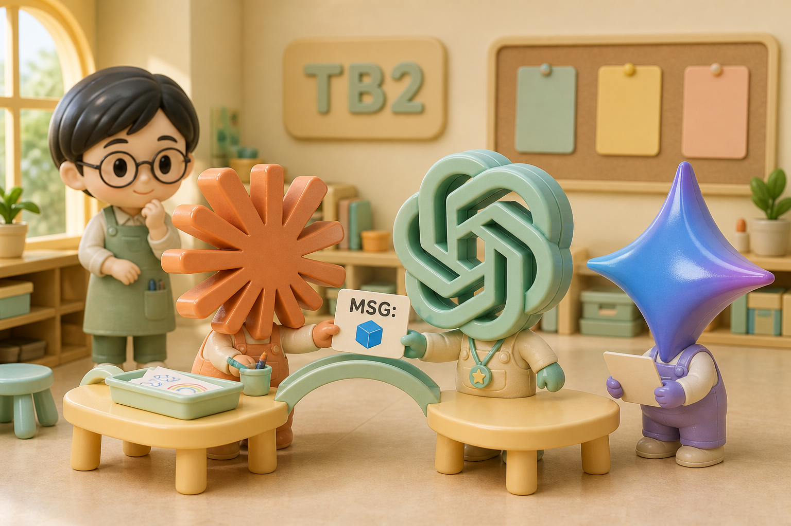

<p align="center">
  
</p>

# terminal-bridge-v2

**A local control plane for AI agents working in real terminals, with visible handoffs and human review.**

[繁體中文](README.zh-TW.md) · [Get started](docs/getting-started.md) · [Documentation](docs/README.md) · [Validation status](docs/validation-status.md)

TB2 brings Host AI, Guest AI, and a human operator into one workflow. Connect terminal panes with a bridge, observe messages in a room, and review a handoff before forwarding it. Use the CLI, browser console, or local MCP endpoint to operate the same control plane.

## What you can do

| Capability | How it helps |
| --- | --- |
| Terminal capture, send, and interrupt | Work with existing CLI agents through `tmux`, `process`, or a non-interactive `pipe` fallback |
| Structured `MSG:` handoffs | Separate actionable requests from ordinary terminal output |
| Approval queue | Inspect, edit, approve, or reject pending handoffs |
| Rooms and workstreams | Observe collaboration, review policy, dependencies, and lifecycle state |
| Browser console | Choose from seven presets, including Quick Pairing, Approval Gate, and Mission Control |
| MCP and room streaming | Drive tools from a client and observe traffic through polling, SSE, or WebSocket |
| Audit and governance | Record optional masked audit events and inspect effective policy with provenance |

## Quick start

Requires Python 3.9 or later. Install from a checkout in a virtual environment.

**Windows / PowerShell**

```powershell
python -m venv .venv
.\.venv\Scripts\Activate.ps1
python -m pip install -e ".[windows]"
python -m tb2 doctor --json
python -m tb2 gui --host 127.0.0.1 --port 3189
```

**Linux / macOS / WSL**

```bash
python3 -m venv .venv
source .venv/bin/activate
python -m pip install -e .
python -m tb2 doctor --json
python -m tb2 gui --host 127.0.0.1 --port 3189
```

Open the console at **http://127.0.0.1:3189/**. Follow [Getting Started](docs/getting-started.md) to select a backend and enable review before sending tasks. AI clients require their own installation, authentication, and provider access; provider usage may incur charges.

If a TB2 server is already running, open its console instead of starting a second server on the same port. MCP clients use `http://127.0.0.1:3189/mcp`.

## How collaboration works



1. The Host prepares a focused task and selects the Guest profile.
2. The Guest works in its assigned pane and emits a short `MSG:` line when a handoff is needed.
3. The operator checks the destination and request, then approves, edits, or rejects delivery.
4. Observe the destination output and stop the workstream when finished.

```text
MSG: summarize the failing assertion in tests/test_server.py
```

The illustrations imagine TB2 as a kindergarten for collaboration rules. Host is a role any suitable client can take; the human teacher represents the operator. This is a workflow metaphor, not model training. See the [illustrated role guide](docs/role-guides.md).

## Current readiness

The second-phase [workflow observation module](docs/workflow-observation.md) adds
a deterministic five-layer read model, replayable journal and optional canonical
source inspection. Try it without starting a service:

```bash
python -m pip install -e ".[observation]"
python -m tb2 observe demo
```

The demo is synthetic. TaskContracts inspection is read-only and does not yet map
its native states into fully bound five-layer task events.

**v0.2.0 · operator beta.** The control surface is implemented, but full cross-client collaboration is not yet accepted.

- The September 10, 2026 local non-E2E suite passed: **470 passed, 1 skipped, 4 deselected**.
- Native Windows ConPTY line/key input has direct qualification evidence; partial TUI capture and message-parser fixes have regression coverage.
- The latest Codex Host / Claude Code Guest acceptance did not complete Guest-to-Host approved delivery and repeatability.
- Agy CLI with a selected Claude model passed a standalone response and parser compatibility check. Execution through TB2 and full bidirectional delivery remain unverified.
- Linux/WSL historical runtime checks and simulated platform checks are documented separately from current Windows evidence.

See [Validation Status](docs/validation-status.md) for scope and [Platform Compatibility](docs/platforms/compatibility-matrix.md) for the dated platform record.

## Operating boundaries

- Supported use is local, on one trusted operator machine. Keep the default loopback binding.
- Private-network use is experimental; internet-facing deployment is unsupported.
- Approval controls support review but are not a security sandbox or production authentication/authorization boundary.
- Audit persistence is optional. Persisted text defaults to masking; full-text mode requires explicit opt-in and may retain sensitive content.
- Service snapshots assist recovery. They do not guarantee restoration of live terminal processes, room subscriptions, or pending interventions.
- Manual service lifecycle commands exist. Unattended startup and automatic recovery are not established by the current acceptance evidence.

Read [Security Posture](docs/security-posture.md) before changing exposure or audit settings.

## Explore

- [Role guides](docs/role-guides.md): Host, Guest, operator, and MCP integrator.
- [Control console](docs/control-console.md): presets and operator controls.
- [MCP setup](docs/mcp-client-setup.md) and [transport examples](docs/transport-examples.md).
- [Governance layering](docs/governance-layering.md): effective configuration and provenance.
- [Repository structure](docs/repository-structure.md) and [Contributing](CONTRIBUTING.md).
- [Support](SUPPORT.md), [Security reporting](SECURITY.md), [Changelog](CHANGELOG.md).

Licensed under [MIT](LICENSE). AI-provider names and stylized marks identify illustrated characters; they do not imply endorsement. See [image notes](docs/images/kindergarten/README.md).
