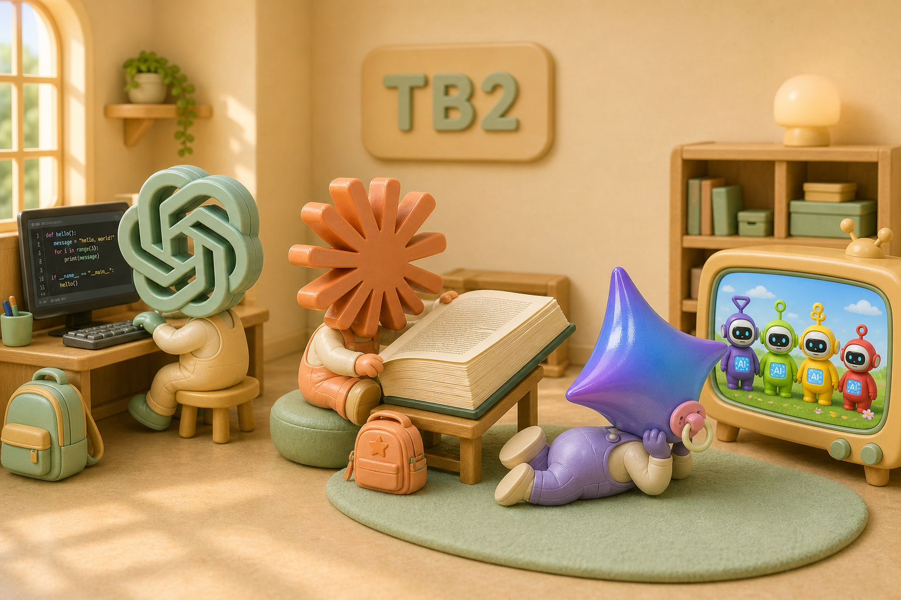

# TB2 Kindergarten Illustrations

Big-headed characters, sculptural logo heads, plastic toy materials, and warm photographic lighting turn collaboration roles into classroom scenes.

| Image | Use |
| --- | --- |
| [README banner](05-readme-banner.png) | 3:1 hero, 2172 × 724 |
| [Welcome](01-welcome.png) | Role-guide opening |
| [MSG lesson](02-msg-class.png) | One actionable handoff at a time |
| [Review lesson](03-review-class.png) | Review before changing a shared build |
| [Recess](04-recess.png) | Series outtake |

Codex codes at a computer, Claude reads a huge book, and Gemini watches AI-style Teletubbies with a pacifier. This is playful characterization, not a model capability comparison.

Generated with built-in image_gen in the user's requested style. AI brand and Teletubbies identifiers belong to their respective rights holders. Stylized depictions do not imply authorization, affiliation, or endorsement, and no third-party trademark or character sublicensing is claimed. The code's MIT license does not grant third-party trademark rights. Full prompts and machine-local paths remain local and are not included in this asset directory.

[Back to documentation](../../README.md)
